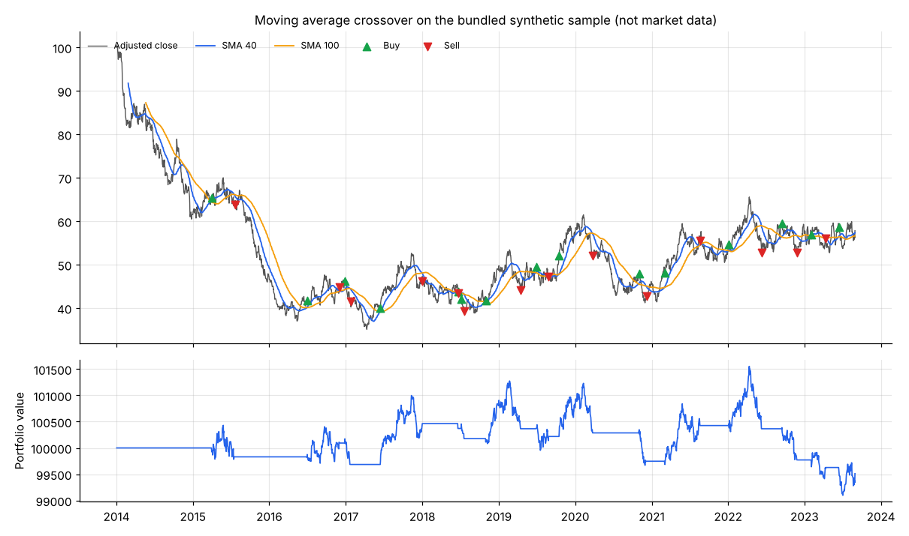

# Event-driven backtester & securities master

[](https://github.com/Matthis44/Backtesting_PY/actions/workflows/tests.yml)


A Python backtesting engine for equity strategies, fed by a small **securities master**:
a MySQL database of reference data (S&P 500 constituents, data vendors) and validated
daily prices, loaded by idempotent scripts.

The engine is **event-driven**: bars are replayed one at a time and every component
reacts to events on a single queue, the same way it would in live trading. This makes
look-ahead bias structurally impossible and lets the same strategy code run on
historical or live data.



## Highlights

- **Data pipeline**: S&P 500 constituents scraped from Wikipedia, daily OHLCV and
  adjusted prices from Yahoo Finance, normalised and validated before loading.
- **Data quality checks**: rows with missing values, non-positive prices, inconsistent
  OHLC (`low > close`, `high < open`…), negative volume or duplicate dates are dropped
  and logged per ticker.
- **Idempotent loads**: unique keys on `(vendor, symbol, date)` and upserts, so a reload
  refreshes prices instead of duplicating them.
- **Pluggable components**: data handlers (CSV, MySQL, live Binance stream), strategies
  and execution share abstract interfaces.
- **Multi-asset alignment**: symbols are aligned on a common calendar and gaps are
  forward-filled.
- **Performance analytics**: annualised Sharpe ratio, drawdown relative to the
  high-water mark, longest drawdown duration.
- **Tested**: 18 unit and end-to-end tests (P&L checked by hand), linting, CI on
  Python 3.10 to 3.13.

## Architecture

```
            ┌──────────────┐  MARKET   ┌──────────┐  SIGNAL   ┌───────────┐
 prices ──▶ │ DataHandler  │ ────────▶ │ Strategy │ ────────▶ │ Portfolio │
            │ CSV / MySQL  │           └──────────┘           │ positions │
            └──────────────┘                                  │ holdings  │
                   ▲                                          └───────────┘
                   │ latest bars        ┌───────────────────┐   │ ORDER  ▲ FILL
                   └─────────────────── │ ExecutionHandler  │ ◀─┘        │
                                        │ (simulated fills) │ ───────────┘
                                        └───────────────────┘
```

For every bar the data handler publishes it, then all resulting events are processed
before the next bar is released.

| Module | Role |
|---|---|
| `backtester/data/` | `HistoricDataHandler` (replay, alignment), CSV and MySQL loaders, experimental Binance WebSocket handler |
| `backtester/strategies/` | `Strategy` interface and a moving average crossover |
| `backtester/portfolio.py` | positions, mark-to-market holdings, order sizing, equity curve |
| `backtester/execution.py` | simulated execution with Interactive Brokers style commissions |
| `backtester/performance.py` | Sharpe ratio and drawdown statistics |
| `scripts/` | securities master: schema, symbol and price loaders, CSV export, sample data |

## Quick start

```bash
git clone https://github.com/Matthis44/Backtesting_PY.git
cd Backtesting_PY
python -m venv .venv && source .venv/bin/activate
pip install -e ".[dev]"

python run_backtest.py                      # runs on the bundled synthetic sample
python run_backtest.py --short 20 --long 50
pytest
```

The sample in `data/sample/` is a reproducible geometric Brownian motion, so the project
runs offline. It is **not** market data.

### With real prices (CSV)

```bash
pip install -e ".[data]"
python -m scripts.download_prices AAPL MSFT --start 2015-01-01 --out data/
python run_backtest.py --csv-dir data AAPL MSFT
```

### With the MySQL securities master

```bash
pip install -e ".[data,mysql]"
cp .env.example .env                        # then set your MySQL credentials
mysql -u root -p < scripts/sql/schema.sql   # tables + Yahoo vendor
python -m scripts.load_sp500_symbols        # ~500 symbols
python -m scripts.load_daily_prices --start 2010-01-01
python run_backtest.py --source mysql AAPL --start 2015-01-01
```

## Database schema

| Table | Content | Key constraints |
|---|---|---|
| `data_vendor` | price sources | unique name |
| `symbol` | ticker, instrument type, name, GICS sector, currency | unique ticker |
| `daily_price` | OHLC, adjusted close, volume per vendor, symbol and date | unique `(vendor, symbol, date)`, index on `(symbol, date)` |

## Simplifying assumptions

These are deliberate and documented so results are read correctly:

- orders are filled immediately at the adjusted close of the signal bar, with no slippage
  or partial fills;
- position size is a fixed lot (100 shares by default);
- the S&P 500 list is today's composition, so a backtest over past years carries
  **survivorship bias**.

## Possible extensions

Point-in-time index membership to remove survivorship bias, a slippage and market impact
model, volatility-based position sizing, intraday bars, Parquet storage.

## License

MIT
